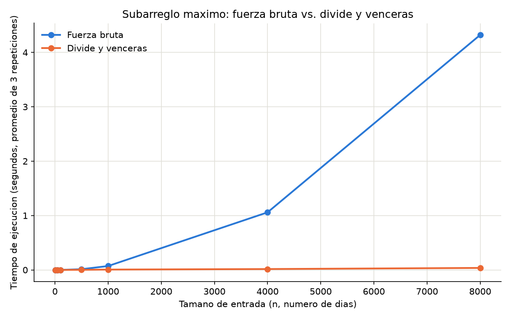

# Laboratorio evaluativo 02 — Dividir y vencer

**Nombre:** Jhon Alejandro Isaza Pérez

## Instrucciones para reproducir el experimento

Desde la raíz del repositorio:

```bash
# 1. Activar el entorno virtual (Windows, Git Bash / PowerShell con venv en la raíz del repo)
source venv/Scripts/activate

# 2. Verificar dependencias (matplotlib ya está registrado en requirements.txt)
pip install -r requirements.txt

# 3. Ubicarse en la carpeta del laboratorio
cd curso-analisis-algoritmos/laboratorios/lab2-divide-y-vencer

# 4. Ejecutar las pruebas de la Parte 1
python pruebas.py

# 5. Ejecutar la medición de la Parte 2 (genera graficas/tiempo_vs_n.png)
python medicion.py
```

---

## Parte 1 — Implementar y verificar las dos soluciones

Código de esta parte: [`subarreglo.py`](subarreglo.py) (las tres funciones) y [`pruebas.py`](pruebas.py) (las verificaciones).

`subarreglo_fuerza_bruta` prueba todos los pares `(i, j)` acumulando la suma dentro del ciclo (sin recalcularla desde cero). `suma_cruzada` hace un barrido lineal desde el punto medio hacia cada extremo para encontrar el mejor tramo que toca ambas mitades. `subarreglo_maximo` resuelve los tres casos (izquierdo, derecho y cruzado) por recursión y devuelve el de mayor suma, sin llamar en ningún momento a la fuerza bruta.

`pruebas.py` verifica, con `assert`, los seis casos pedidos: la serie de ocho días del enunciado (suma 17), un elemento positivo y uno negativo, una serie totalmente negativa (la mejor racha es el valor menos negativo), una serie totalmente positiva (la mejor racha es la serie completa), un caso clásico donde el mejor tramo cruza el punto medio (`[2, -1, -3, 4, -1, 2, 1, -5, 4]`, suma 6), que ninguna función modifica la lista recibida, y 25 listas aleatorias (semilla fija 42, tamaños entre 1 y 60) en las que se compara únicamente la suma devuelta por ambos algoritmos. Las 25 pasaron sin discrepancias.

---

## Parte 2 — Medir y graficar

Código de esta parte: [`medicion.py`](medicion.py).

Se midió el tiempo de `subarreglo_fuerza_bruta` y `subarreglo_maximo` sobre el mismo lote de datos (enteros entre -100 y 100, semilla fija 42) para `n` en `[10, 50, 100, 500, 1000, 4000, 8000]`. Cada medición se repitió 3 veces sobre el mismo lote y se reporta el promedio, para suavizar el ruido de medición, el script verifica en cada tamaño que ambos algoritmos devuelven la misma suma antes de registrar el tiempo.

| n | Fuerza bruta (s, prom. 3) | Divide y vencerás (s, prom. 3) |
|---:|---:|---:|
| 10 | 0.000021 | 0.000034 |
| 50 | 0.000175 | 0.000156 |
| 100 | 0.000637 | 0.000331 |
| 500 | 0.013294 | 0.001955 |
| 1000 | 0.071653 | 0.006438 |
| 4000 | 1.058938 | 0.016192 |
| 8000 | 4.322020 | 0.036668 |



---

## Parte 3 — Análisis

### 1. Recurrencia

La recurrencia de `subarreglo_maximo` es `T(n) = 2·T(n/2) + Θ(n)`: `2·T(n/2)` son las dos llamadas recursivas sobre cada mitad (tamaño `n/2`), y `Θ(n)` es el costo de `suma_cruzada` (dos barridos lineales desde el medio hacia cada extremo). Caso base: `T(1) = Θ(1)`.

Por el método maestro (`a=2, b=2, f(n)=Θ(n)`), `n^(log_b a) = n`. Como `f(n) = Θ(n^(log_b a))`, se cumple el caso 2, y `T(n) = Θ(n^(log_b a) · log n) = Θ(n log n)`.

La fuerza bruta es Θ(n²) porque recorre todos los pares `(i, j)` con `i ≤ j`: el ciclo externo tiene `n` valores de `i`, y el interno recorre de `i` a `n-1`. El total de iteraciones es `Σ(n-i) = n(n+1)/2 = Θ(n²)`.

### 2. Lo medido contra lo esperado

La curva de fuerza bruta se curva hacia arriba al crecer `n` (crecimiento cuadrático), la de divide y vencerás se mantiene casi plana. Entre `n = 4000` y `n = 8000` (n se duplica), fuerza bruta pasa de 1.058938 s a 4.322020 s (**≈4.08×**), divide y vencerás pasa de 0.016192 s a 0.036668 s (**≈2.27×**).

Θ(n²) predice un factor `2² = 4` al duplicar n, el 4.08× medido coincide casi exactamente. Θ(n log n) predice `2 · (log₂8000/log₂4000) ≈ 2.17×`, cercano al 2.27× medido — la diferencia es consistente con el overhead fijo de la recursión en Python, que pesa más cuanto más rápido corre el algoritmo.

### 3. Tamaños pequeños

Divide y vencerás empieza a ganar entre n=10 y n=50: en n=10 fuerza bruta es más rápida (0.000021 s) que divide y vencerás (0.000034 s), pero en n=50 ya se invierte (0.000175 s frente a 0.000156 s), y desde ahí gana siempre con ventaja creciente. Que fuerza bruta gane en n=10 tiene sentido: el overhead de crear llamadas recursivas y combinar tres casos pesa más que recorrer unos pocos pares con dos ciclos anidados. Con cantidades tan pequeñas, la diferencia entre Θ(n²) y Θ(n log n) casi no se nota: domina la constante oculta de cada Θ, mayor en la recursión que en la iteración simple.

### 4. ¿Cuándo conviene dividir?

Para hallar el máximo por divide y vencerás, la recurrencia sería `T(n) = 2T(n/2) + Θ(1)`: se divide en dos mitades, se halla el máximo de cada una por recursión, y combinar solo compara dos números, a diferencia de `suma_cruzada` que necesita un barrido lineal. Por el método maestro (`a=2, b=2, f(n)=Θ(1)`), se cumple el caso 1 y `T(n) = Θ(n)` — el mismo orden que un solo recorrido comparando cada elemento con el máximo acumulado. Dividir no reduce las comparaciones bajo ese recorrido; solo agrega overhead de recursión sin ganar nada asintóticamente, conviene dividir cuando combinar baja el orden de crecimiento frente a la alternativa simple —como en subarreglo máximo, Θ(n log n) contra Θ(n²)—, no cuando ya se resuelve en el mismo orden con un solo recorrido.

### 5. Concepto para la gerente

Recomiendo divide y vencerás (`subarreglo_maximo`) para la cooperativa, tanto para los historiales de ~2.000 días como para las series de sensores con cientos de miles de registros, desde n=50 ya es más rápido que fuerza bruta, con ventaja creciente (ver Parte 2).

Para estimar el tiempo con 1.000.000 de registros extrapolo la tendencia medida, no una regla de tres lineal (que asumiría, incorrectamente, que el tiempo crece proporcional a n). Ajustando `c` en `T(n) ≈ c·n²` con n=4000 y n=8000, `c ≈ 6.69×10⁻⁸` s, en n=1.000.000, `T ≈ 66 857 s` (≈18.6 h) para fuerza bruta,ajustando `c` en `T(n) ≈ c·n·log₂(n)` con los mismos puntos, `c ≈ 3.46×10⁻⁷` s, en n=1.000.000 (log₂n≈19.93), `T ≈ 6.9 s` para divide y vencerás. Son **estimaciones por extrapolación, no mediciones directas**: nadie corrió ninguno de los dos algoritmos con un millón de registros aquí. La diferencia, segundos contra horas, confirma la recomendación.
