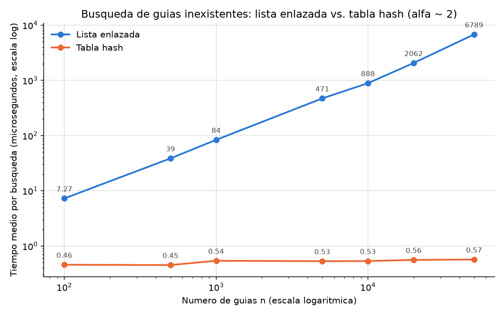
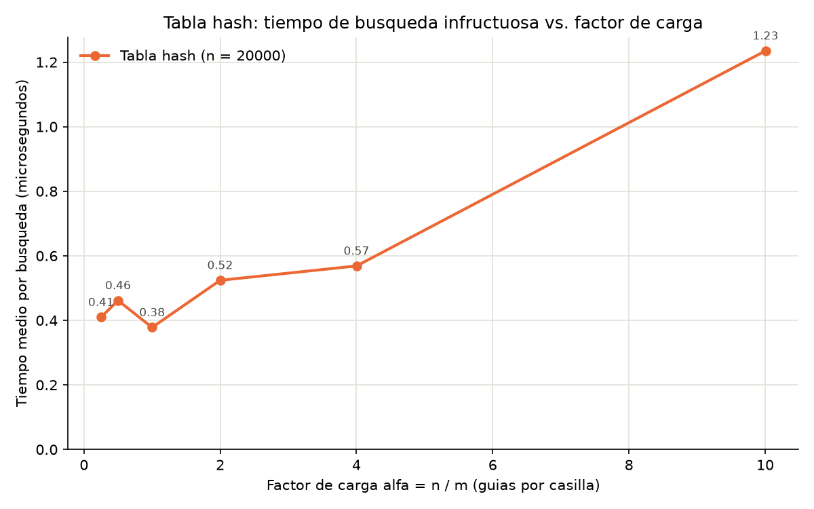

# Laboratorio evaluativo 03 — Estructuras de datos

**Nombre:** Jhon Alejandro Isaza Pérez

## Instrucciones para reproducir el experimento

Desde la raíz del repositorio:

```bash
# 1. Activar el entorno virtual (Windows, Git Bash / PowerShell con venv en la raíz del repo)
source venv/Scripts/activate

# 2. Verificar dependencias (matplotlib ya está registrado en requirements.txt)
pip install -r requirements.txt

# 3. Ubicarse en la carpeta del laboratorio
cd curso-analisis-algoritmos/laboratorios/lab3-estructuras-datos

# 4. Ejecutar las pruebas de la Parte 1
python pruebas.py

# 5. Ejecutar la medición de la Parte 2 (genera las dos gráficas en graficas/, tarda ~40 s)
python medicion.py
```

---

## Parte 1 — Implementar y verificar las dos estructuras

Código de esta parte: [`estructuras.py`](estructuras.py) (`Nodo`, `ListaEnlazada` y `TablaHash`) y [`pruebas.py`](pruebas.py) (las verificaciones).

`ListaEnlazada.insertar` enlaza el nodo nuevo con la cabeza actual en Θ(1), y `buscar` recorre la lista con un `while`. `TablaHash` usa `h(k) = k mod m` y una `ListaEnlazada` propia en cada casilla (encadenamiento): insertar y buscar solo tocan la lista de la casilla `h(k)`. No se usa `dict`, `set` ni `hash()` de Python en las estructuras.

`pruebas.py` verifica con `assert`:

- La serie de cuatro guías del enunciado en la lista y en la tabla (m = 7): búsquedas exitosas (`"en reparto"`, `"entregado"`), una búsqueda infructuosa (`None`) y el `tamano`.
- Estructuras vacías: buscar devuelve `None` y el factor de carga es 0.
- La colisión forzada con m = 7: las guías 10, 24 y 17 caen en la casilla 3, las tres se encuentran después de insertarlas, la lista de la casilla 3 tiene longitud 3 y las demás casillas quedan vacías.
- Una guía inexistente que cae en una casilla ocupada (31 mod 7 = 3) devuelve `None`, lo que confirma que se compara la guía y no solo la casilla.
- `factor_carga() == 3 / 7` tras esas tres inserciones.
- 25 colecciones aleatorias (semilla 42, n entre 1 y 500, m entre 1 y 100, guías de diez dígitos): lista y tabla devuelven el mismo estado en todas las guías existentes y `None` en 50 guías inexistentes por colección; además `factor_carga() == n / m`.

Todas las pruebas pasaron.

---

## Parte 2 — Medir y graficar

Código de esta parte: [`medicion.py`](medicion.py).

**Cómo se midió.** Las guías se generan con semilla fija (42) como enteros distintos de diez dígitos, y las mismas guías se cargan en la lista y en la tabla. En cada valor de `n` se verifica, sobre una muestra de 100 guías existentes, que lista y tabla devuelven el mismo estado. Las 200 guías inexistentes salen de `generar_guias_inexistentes` (semilla 7). Con `time.perf_counter()` se cronometran **solo las búsquedas** de esas 200 guías: el lote se repite 5 veces en la lista y 201 en la tabla (una búsqueda en la tabla dura menos de 1 µs y es muy sensible al ruido del sistema), y se reporta el **mínimo** dividido entre 200, porque el ruido solo suma tiempo. Las gráficas usan escala logarítmica en el experimento A para que las dos curvas sean legibles en los mismos ejes.

**Experimento A** — `m` primo cercano a `n / 2`, de modo que α ≈ 2:

| n | m | α | Lista (µs/búsqueda) | Tabla (µs/búsqueda) |
|---:|---:|---:|---:|---:|
| 100 | 47 | 2.13 | 7.27 | 0.457 |
| 500 | 251 | 1.99 | 38.58 | 0.451 |
| 1 000 | 499 | 2.00 | 83.64 | 0.540 |
| 5 000 | 2 503 | 2.00 | 470.69 | 0.530 |
| 10 000 | 4 999 | 2.00 | 888.21 | 0.533 |
| 20 000 | 10 007 | 2.00 | 2 062.49 | 0.559 |
| 50 000 | 24 989 | 2.00 | 6 789.14 | 0.568 |



**Experimento B** — n fijo en 20 000 y `m` primo cercano a `n / α`:

| α | m | Tabla (µs/búsqueda) |
|---:|---:|---:|
| 0.25 | 79 999 | 0.409 |
| 0.50 | 40 009 | 0.462 |
| 1.00 | 19 997 | 0.378 |
| 2.00 | 10 007 | 0.524 |
| 4.00 | 4 999 | 0.569 |
| 10.00 | 1 999 | 1.235 |



Los valores exactos cambian unas décimas entre ejecuciones (dependen de la carga del equipo); la forma de las curvas se mantiene.

---

## Parte 3 — Análisis

### 1. Costo teórico

La lista no tiene orden que permita descartar nodos: para afirmar que una guía **no** está hay que compararla con los `n` nodos, desde la cabeza hasta `None`. Son `n` comparaciones: Θ(n).

En la tabla, calcular `h(k) = k mod m` cuesta Θ(1) y luego solo se recorre la lista de la casilla `h(k)`. Bajo el supuesto de **hash uniforme simple** (cada guía cae con igual probabilidad en cualquiera de las `m` casillas, independientemente de las demás), la longitud esperada de cada lista es `n / m = α`. Una búsqueda infructuosa recorre esa lista completa: Θ(1) + Θ(α) = Θ(1 + α). Si `m` crece proporcional a `n`, α es constante y la búsqueda es Θ(1).

Si todas las guías cayeran en la misma casilla (por ejemplo, todas múltiplos de `m`), esa lista tendría longitud `n` y la tabla se comportaría como la lista enlazada: Θ(n). Por eso `m` es primo.

### 2. Lo medido contra lo esperado

En la primera gráfica, de `n = 20 000` a `n = 50 000` (`n` ×2.5), la lista pasa de 2 062 a 6 789 µs (**×3.29**) y la tabla de 0.559 a 0.568 µs (**×1.02**). De 10 000 a 20 000 (`n` ×2): lista **×2.32**, tabla **×1.05**.

La lista sigue Θ(n): en escala log-log es una recta de pendiente ≈ 1 (de 7.27 a 6 789 µs mientras `n` crece ×500). En tamaños grandes crece algo más que `n` porque los nodos dispersos en memoria fallan la caché (0.089 µs por nodo en `n = 10 000`, 0.136 µs en 50 000). La tabla se queda entre 0.45 y 0.57 µs aunque `n` crezca 500 veces: Θ(1) con α constante.

En la segunda gráfica, entre α = 0.25 y α = 1 el tiempo casi no cambia (0.38–0.46 µs): domina el término constante (hash, llamada, acceso a la casilla). Desde α = 2 crece casi en línea recta, de 0.524 µs a 1.235 µs en α = 10: unos **0.09 µs por guía adicional en la cadena**, el mismo costo por nodo de la lista. Una constante más un término lineal en α es justo Θ(1 + α).

### 3. Las colisiones

Una colisión ocurre cuando dos guías distintas tienen el mismo hash. Es inevitable: hay 9·10⁹ guías posibles y solo `m` casillas, y aunque `m > n` la probabilidad de coincidencias crece rápido (paradoja del cumpleaños: 23 claves en 365 casillas ya superan el 50 %). Con `m = 7`: 10, 24 y 17 dan residuo **3**.

- **Encadenamiento** (el implementado): la casilla 3 guarda la lista `17 → 24 → 10`. *Ventaja:* α puede pasar de 1, el desempeño se degrada suavemente y borrar es simple. *Costo:* memoria para punteros y nodos dispersos.
- **Direccionamiento abierto** (sondeo lineal): todo va en el arreglo. 10 ocupa la casilla 3; 24 la encuentra ocupada y queda en la 4; 17 prueba 3 y 4 y queda en la 5. *Ventaja:* sin punteros, memoria contigua. *Costo:* exige α < 1, se forman racimos (el costo crece como 1/(1 − α)) y borrar requiere marcas especiales.

### 4. Tabla hash o árbol de búsqueda

La tabla **no sirve** para "guías entre X y Y": el hash dispersa guías consecutivas en casillas sin relación (1000000010 y 1000000011 quedan en casillas distintas). Habría que revisar las `n` guías o preguntar por cada una de las Y − X + 1 posibles.

Un **árbol de búsqueda binario** mantiene el orden: se baja hasta X y se hace un recorrido en orden que se detiene al pasar Y, con costo Θ(h + k), donde `h` es la altura y `k` las guías reportadas.

Si las 400 000 guías llegan **ordenadas** y se insertan una a una, cada una queda como hijo derecho de la anterior: el árbol degenera en una lista de altura **399 999**, y buscar una guía inexistente cuesta unas **400 000 comparaciones**, como la lista enlazada. Un árbol **equilibrado** (AVL, rojo-negro) tiene altura ≈ log₂ 400 000 ≈ **19**: unas 19 comparaciones, unas 20 000 veces menos.

### 5. Concepto para la jefa de operaciones

Recomiendo **una combinación**: una **tabla hash** con encadenamiento para el call center, con `m` primo y rehash para mantener α ≈ 2, y un **árbol equilibrado** con las mismas guías para el monitoreo por rango. Cada envío nuevo se inserta en ambos.

**Estimación** (no medición) para una guía inexistente con 5 000 000 de envíos:

- **Lista:** la primera gráfica muestra crecimiento lineal, así que extrapolo con el costo por nodo medido en `n = 50 000` (0.136 µs, que ya incluye fallas de caché): 5 000 000 × 0.136 µs ≈ **0.7 s por consulta**, como piso, porque el costo por nodo podría seguir subiendo.
- **Tabla con α ≈ 2:** la curva es plana entre 100 y 50 000 guías; si el rehash mantiene α constante, el tiempo no depende de `n`: **≈ 0.6 µs**, quizá 1 µs por caché. Sin rehash (`m = 24 989`, α ≈ 200), la recta de la segunda gráfica (≈ 0.35 + 0.09·α µs) da **≈ 18 µs**.
- **Árbol equilibrado:** ≈ log₂ 5 000 000 ≈ 23 comparaciones, y el rango cuesta 23 + k.

La tabla es cerca de un millón de veces más rápida que la lista para el call center, y el árbol resuelve el rango, que la tabla no puede.
